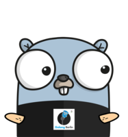

[](https://circleci.com/gh/alexfalkowski/go-signal)
[](https://codecov.io/gh/alexfalkowski/go-signal)
[](https://pkg.go.dev/github.com/alexfalkowski/go-signal/v2)
[](https://masterminds.github.io/stability/active.html)

# 📡 go-signal

Build Go applications with dependency injection, startup hooks, and orderly
shutdown around OS signals. The public application API lives in the root
`github.com/alexfalkowski/go-signal/v2` package.

## 📦 Install

Use the Go toolchain version declared in [go.mod](go.mod).

```sh
go get github.com/alexfalkowski/go-signal/v2
```

## 🧩 Build an application

`Constructor` registers factories, `Decorate` changes provided values, and
`Register` executes setup functions before `NewApp` returns. Setup functions
receive `Lifecycle` and call `Append` to register hooks. Acquire resources in
`OnStart` and release them in `OnStop`.

```go
app, err := signal.NewApp(
    signal.Constructor(NewConfig, NewServer),
    signal.Register(RegisterRoutes),
)
if err != nil {
    return err
}
return app.Serve(ctx)
```

Import `github.com/alexfalkowski/go-signal/v2`. See the
[executable examples](example_test.go) for complete usage.

Dig supports `signal.In`, `signal.Out`, optional dependencies, and value groups.
All constructors are registered before decorators and setup functions. Unused
constructors are not called. `Module` combines options without creating scopes.
Construction panics become initialization errors. Hooks also recover panics;
match them with `errors.Is(err, signal.ErrRecovered)`.

## ▶️ Run and stop

`App.Serve` starts hooks, waits for cancellation, SIGINT/SIGTERM, an additional
signal, or application-local shutdown, then stops hooks. `App.Run` starts and
immediately stops a short-lived command whose work lives in start hooks.
Startup and cleanup phases are internal. Register hooks during setup before
executing the application. Create a fresh application for each command execution
or retry. Each application supports one lifecycle execution; reusing it after
startup failure or shutdown is unsupported.

Startup stops at the first error or cancellation and rolls back successfully
started hooks. Cleanup runs hooks in reverse order and joins errors. An inactive
application's cleanup is a no-op.

The default startup and stop deadlines are 15 seconds. Configure them with
`signal.StartTimeout` and `signal.StopTimeout`; `NewApp` rejects non-positive values.
`signal.ErrTimeout` marks an expired wait and also matches
`context.DeadlineExceeded`. An available startup or cleanup result takes
precedence over waiting-context cancellation.
After a startup failure, rollback gets a fresh stop deadline independent of the
startup deadline. The startup error is joined with any rollback error.

Deadlines bound waiting, but cannot forcibly interrupt a Go callback. Hooks
must observe cancellation. A startup callback can finish after its caller has
timed out; successfully acquired resources are cleaned up afterward. Lifecycle
transitions are serialized. Cleanup errors occurring after a canceled wait
cannot be included in its returned error.

## 🛑 Request shutdown

Inject `signal.Shutdowner` into application workers and call `Shutdown(code)`.
Requests belong to one application and can be recorded during construction,
startup, or cleanup. The first requested code wins. Requests made during cleanup
are included if recorded before the cleanup wait returns. An already-buffered
request keeps its code when cancellation or a startup error occurs. Programmatic
shutdown does not send an OS signal.

A non-zero requested code becomes `*signal.ExitError`, joined with startup or
cleanup errors. Find it with `errors.As`. The caller owns process exit.

`App.Run` and `App.Serve` handle the programmatic request and cleanup internally.
`App.Serve` additionally handles OS signals.

## 📡 OS signals

`App.Serve` listens for SIGINT/SIGTERM and any additional signals through
`os/signal.NotifyContext`. It unregisters its signal notifications on return.
Use serving as the final blocking application call.

## ⏱️ Periodic work

`signal.Timer(ctx, interval, tick)` runs a callback at a positive interval, with
the first call after one interval. Calls run sequentially; slow callbacks may
drop ticks. Cancellation between callbacks returns nil. Callback errors stop
the timer and are returned unchanged, while panics match `signal.ErrRecovered`.
Non-positive intervals return `signal.ErrInvalidInterval`.

Timer blocks, so start it with `go-sync.Go` from an `OnStart` hook. Give the
worker its own cancelable context, then cancel and await the task in `OnStop`.
Callbacks must observe cancellation; the stop context bounds waiting for them.
See the [executable example](example_test.go) and [manual worker](cmd/main.go).

## 🧪 Test helpers

Import `github.com/alexfalkowski/go-signal/v2/signaltest` to exercise component
hooks through the same internal engine used by applications:

```go
lc := signaltest.NewLifecycle(t)
t.Cleanup(lc.RequireStop)

// Pass lc as signal.Lifecycle to components, or register hooks with lc.Append.
lc.RequireStart()
```

The helper accepts tests and benchmarks. `RequireStart` and `RequireStop` use
30-second deadlines and fail on execution errors; callbacks must honor their
contexts. Cleanup uses a fresh context after the test context is canceled.
Call the helper's `Start(ctx)` and `Stop(ctx)` directly to assert expected errors.
These phase methods are for component tests; applications expose `Run` and
`Serve`. See the [helper tests](signaltest/lifecycle_test.go).

## 🔄 V2 migration

- Import `github.com/alexfalkowski/go-signal/v2` for application construction,
  hooks, registration, shutdown requests, and signal helpers. The lifecycle
  implementation is internal.
- Build an application with `signal.NewApp` and handle its initialization error.
  Register setup functions with `signal.Register`, then use `App.Serve` for
  servers or `App.Run` for commands. Work belongs in lifecycle hooks.
- The former process-wide lifecycle helpers and public `di`/`lifecycle` package
  paths are retired. Applications own their lifecycle and shutdown state.
- To replace Fx wrappers, use `Constructor`, `Register`, `Module`, `Decorate`,
  `In`, and `Out` from the root package. Inject `signal.Lifecycle` and keep
  `Append` calls for hooks. Use `signal.Shutdowner.Shutdown(code)` for
  application shutdown. Inspect `*signal.ExitError` for requested exit codes.
- Replace Fx timeout options with `signal.StartTimeout`/`signal.StopTimeout`.
  Construction panics are always recovered and no application logger is
  installed. Return prebuilt values from constructors and use `Register` to
  capture constructed values.
- Replace `fxtest.NewLifecycle` with `signaltest.NewLifecycle`.
- Replace the old Timer timeout/interval/Hook arguments with
  `Timer(ctx, interval, tick)`. Lifecycle hooks now own worker startup and cleanup;
  use `go-sync.Go` to launch background work.

## 🧪 Development

Initialize the shared `bin` tooling before running Make targets from a fresh
clone. The submodule uses GitHub SSH:

```sh
git submodule sync
git submodule update --init
```

### Benchmarks

```sh
make benchmarks
make lifecycle-benchmarks
make package=. benchtime=10x benchmark
```

### Fuzz tests

```sh
make fuzzes
make lifecycle-fuzz
make package=. name=FuzzLifecycleHookMatrix fuzztime=1000x fuzz
```

## 🧪 Manual application

[cmd/main.go](cmd/main.go) uses `Constructor` to resolve a `Process` from its
configuration, logger, and `Shutdowner`. `RegisterProcess` registers the process's
`Start` and `Stop` methods with the application's `Lifecycle`. The process owns
its `go-sync` task, uses `signal.Timer` for periodic work, and requests
application-local shutdown on worker failure. This is a manual testing
script rather than an installed CLI. After fresh-clone setup, run:

```sh
make run param=terminate
```

Use `param=start` or `param=timer` to wait for an OS signal. The `timer` mode
uses `signal.Timer` to log every second. The `terminate` mode uses the same
helper to request successful application shutdown on its first two-second tick.
